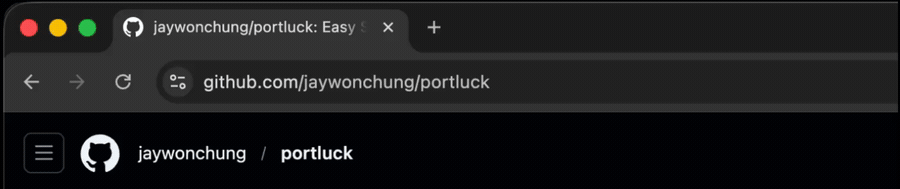

# Portluck

SSH port-forward to a remote port from the Chrome address bar, tied to a tab's lifetime.
Type `pf somenode:8888` in your browser address bar and Portluck runs `ssh -N -L 127.0.0.1:8888:127.0.0.1:8888 somenode`, opens `http://localhost:8888`, and tears the tunnel down when you close the tab.



Chrome extensions can't spawn `ssh`, so Portluck is two parts: `extension/` (MV3, owns the omnibox keyword and tab lifecycle) and `native-host/` (a small Rust binary that runs and supervises `ssh`).

## Prerequisites

- macOS with Chrome. It should work with Linux and other Chromium-based browsers, but I haven't tested them.
- Rust toolchain.
- SSH (`ssh`). Your SSH config (`~/.ssh/config`) will be used to resolve hosts.

## Install

The extension ID is pinned (`key` in `manifest.json`) to `ieefaffakndbkfepmnpkolganahdnafg`, so there is no ID to copy around.

1. Build and register the host: `scripts/install.sh [chrome|brave|edge|canary]`.
   This compiles the Rust binary and writes the native-messaging manifest into the browser's `NativeMessagingHosts` directory, pointing Chrome at the binary and allowing only the pinned extension ID.
2. Load `extension/` unpacked at `chrome://extensions` (Developer mode on).

## Usage

Type `pf` ("port forward"), a space, then `[user@]host:port`:

```
pf somenode:8888            forward remote 8888 to localhost:8888
pf somenode:8888:9000       remote 8888 to localhost:9000 (choose the local port)
pf user@somenode:8888       connect as a specific SSH user
```

Closing the tab tears down the tunnel.

## Defaults

- Local port defaults to the remote port; if busy, an unused one is picked and the tab uses it.
- The tunnel is reachable only from your machine, not your LAN.
- Uses HTTP.

## Troubleshooting

- You get "native messaging host not found" or "forbidden": run `scripts/install.sh` and reload the extension.
- Tab won't load: the service isn't on that port, it's `https`, or `ssh` auth failed. The exact `ssh` error is in the failure notification, or at `chrome://extensions` -> Portluck -> "Inspect views: service worker".
- Updated the host or moved the repo? Re-run `scripts/install.sh`, then reload the extension.

Tunnels live with the extension's service worker, which is kept awake while any tunnel is active.
If Chrome suspends it anyway, the host exits and tunnels drop (re-run `pf`).
This tradeoff was made to ensure we don't get any orphaned tunnels.
It should be easier to just re-open the tab with a new `pf` command than to manually find and kill orphaned `ssh` processes.
